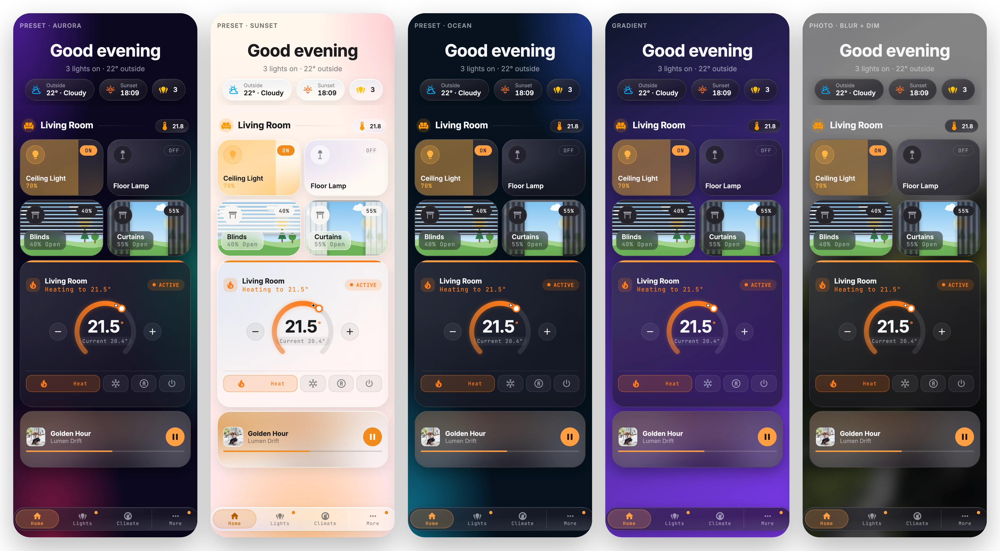

# Background: the dashboard behind your cards

[← Back to README](../../README.md)



The background card paints the dashboard itself. You can match your Glide theme, pick a preset, use a colour or gradient, or use your own photo with blur and dim. The card is invisible on the dashboard; while you edit, it shows a small label, and the editor previews your changes live.

Put it anywhere on a view. By default it paints only that view, so every page can have its own background. Set `scope: dashboard` and it becomes the background of every view that doesn't have its own background card. It also works on views with no Glide cards at all.

## Options

| Option | Type | Default | Description |
| --- | --- | --- | --- |
| `background` | `theme` \| `preset` \| `color` \| `image` | `theme` | What to paint. `theme` uses the Glide theme's own backdrop (the card's `theme`, else your dashboard's `glide-theme`), dark or light with HA. |
| `preset` | see [Presets](#presets) | `aurora` | Used with `background: preset`. |
| `color` | CSS colour | | Used with `background: color`. |
| `color2` | CSS colour | | Adds a second colour, so `color` becomes a gradient. |
| `angle` | 0–360 | `135` | Gradient direction in degrees. |
| `image` | URL | | Used with `background: image`, for example `/local/wall.jpg`. |
| `image_night` | URL | | Shown instead of `image` while `sun.sun` is below the horizon. |
| `blur` | 0–40 | `0` | Blurs the photo, in px. |
| `dim` | 0–90 | `0` | Dims the photo, in %: darker in dark mode, lighter in light mode, so the cards stay readable. |
| `animate` | boolean | `false` | A slow drift for theme, preset and gradient backgrounds. It stays off in lite mode and when the device asks for reduced motion. |
| `scope` | `view` \| `dashboard` | `view` | `dashboard` applies it to every view without its own background card. |
| `mode` | `auto` \| `dark` \| `light` | `auto` | Which version of a theme or preset to use. `auto` follows HA. |

## Presets

`aurora`, `sunset`, `ocean`, `forest`, `midnight`, `dusk`, `pastel`, `mint`, `rose`, `graphite`. Each has a dark and a light version.

## Examples

<details>
<summary>Match the Glide theme on every view</summary>

```yaml
type: custom:glide-card
card_type: background
scope: dashboard
```
</details>

<details>
<summary>A drifting Aurora preset for one view</summary>

```yaml
type: custom:glide-card
card_type: background
background: preset
preset: aurora
animate: true
```
</details>

<details>
<summary>Your own photo, blurred, with a night version</summary>

```yaml
type: custom:glide-card
card_type: background
background: image
image: /local/garden-day.jpg
image_night: /local/garden-night.jpg
blur: 12
dim: 30
```
</details>

<details>
<summary>A two-colour gradient</summary>

```yaml
type: custom:glide-card
card_type: background
background: color
color: "#0f172a"
color2: "#7c3aed"
angle: 150
```
</details>

## Notes

- If a view has its own `background:` in HA, the Glide background is painted on top of it.
- Cards, pop-ups and the nav bar are not affected; the background sits behind the view.
