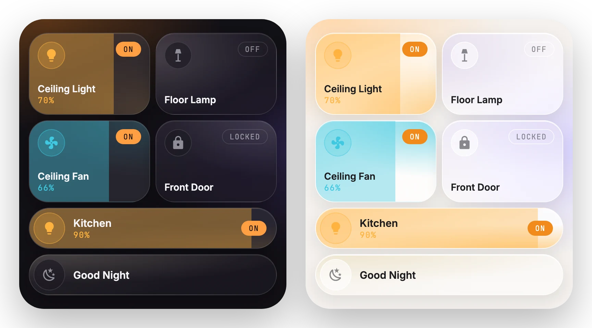
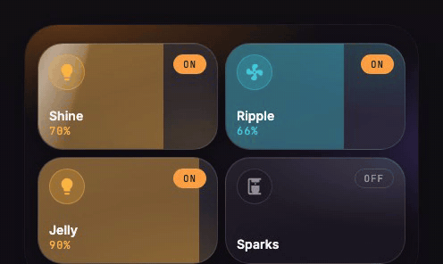

# Button

[← Back to README](../../README.md)



A tile or a pill for any entity. Tap toggles it, hold opens more-info, and swiping sideways sets brightness, fan speed or cover position. The fill shows the level as you swipe, and HA updates when you let go.



## Options

| Option | Type | Default | Description |
| --- | --- | --- | --- |
| `entity` | entity | | The entity to control. Leave it out for a summary tile driven by templates. |
| `name` | string / template | friendly name | Name on the tile. |
| `icon` | icon / template | entity icon | For example `mdi:lamp`. |
| `layout` | `tile` \| `pill` | theme default | A tile is 2 grid rows. A pill is one full-width row. |
| `slider` | boolean | `true` | Swipe to set brightness, speed or position. |
| `color` | color / template | per domain | An HA color name (`amber`, `light-blue`, ...) or any CSS color. |
| `fill` | boolean | `true` | `false` keeps the soft glass gradient instead of a solid fill when on. |
| `secondary` | string / template | brightness / position | The line under the name. A line break in the text starts a new line (tile look). |
| `badge` | string / template | state | The corner pill. |
| `size` | `full` \| `compact` \| `slim` | `full` | See [sizes](../options.md#sizes). |
| `tap_action` / `hold_action` / `double_tap_action` | action | toggle / more-info / none | Standard HA actions. `navigate` to a `#hash` opens a [pop-up](popup.md). |

Covers have a few more options; see [Cover](cover.md).

## Examples

<details>
<summary>Light tile</summary>

```yaml
type: custom:glide-card
card_type: button
entity: light.ceiling
```
</details>

<details>
<summary>Pill row with a custom color</summary>

```yaml
type: custom:glide-card
card_type: button
entity: lock.front
layout: pill
color: teal
```
</details>

<details>
<summary>Summary tile with templates ("3 of 7 on")</summary>

`name`, `secondary`, `badge`, `icon` and `color` accept Home Assistant templates, like a Mushroom template card. HA renders them and keeps them updated live.

```yaml
type: custom:glide-card
card_type: button
name: Lights
icon: mdi:lightbulb-group
secondary: >-
  
  {{ lights | select('is_state', 'on') | list | count }} of {{ lights | count }} on
badge: "{{ states('sensor.outdoor_lights_on') }} outside"
color: "{{ 'amber' if is_state('light.living_room', 'on') else 'grey' }}"
tap_action:
  action: navigate
  navigation_path: "#lights"
```
</details>

<details>
<summary>Soft (pastel) button</summary>

`fill: false` keeps the glass gradient in the button's color instead of a solid fill. A light custom color is also used in a darker shade for the icon and the meta line, so they stay readable.

```yaml
type: custom:glide-card
card_type: button
entity: light.bedroom
color: "#F3D9A4"
fill: false
```
</details>

> [!TIP]
> The tap animation can be set per card (`tap_animation: ripple`) or for the whole dashboard. See [tap animations](../options.md#tap-animations).
