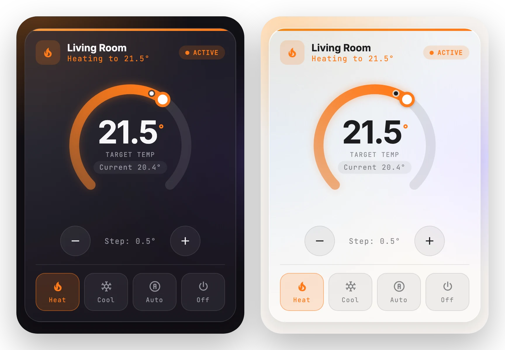

# Climate

[← Back to README](../../README.md)



A thermostat dial. Drag the arc or use −/+ to set the target, and pick a mode below. The color follows the mode (heat, cool, auto, off).

## Options

| Option | Type | Description |
| --- | --- | --- |
| `entity` | entity | **Required.** A `climate` entity. |
| `name` | string | Overrides the friendly name. |
| `size` | `full` \| `compact` \| `slim` | `slim` gives a small dial with −/+ beside it. |

## Example

```yaml
type: custom:glide-card
card_type: climate
entity: climate.living
```
