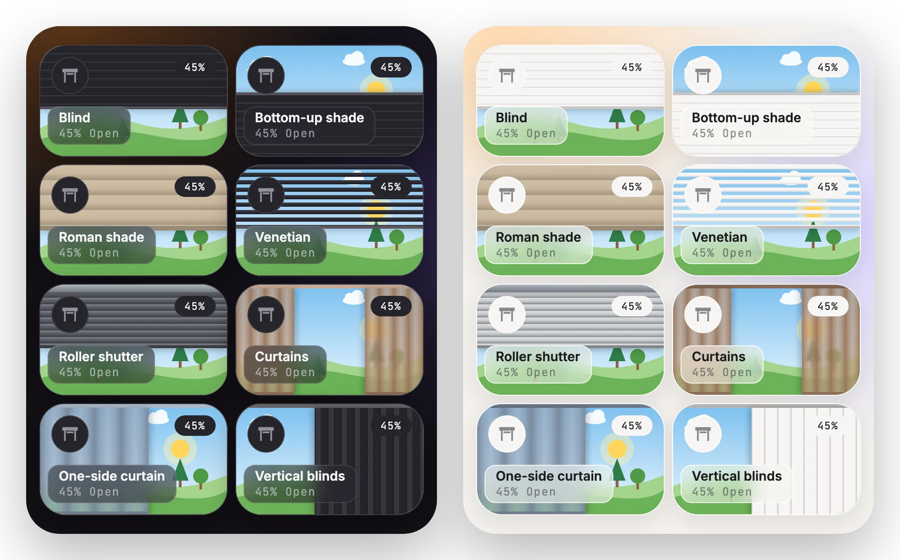
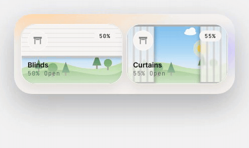
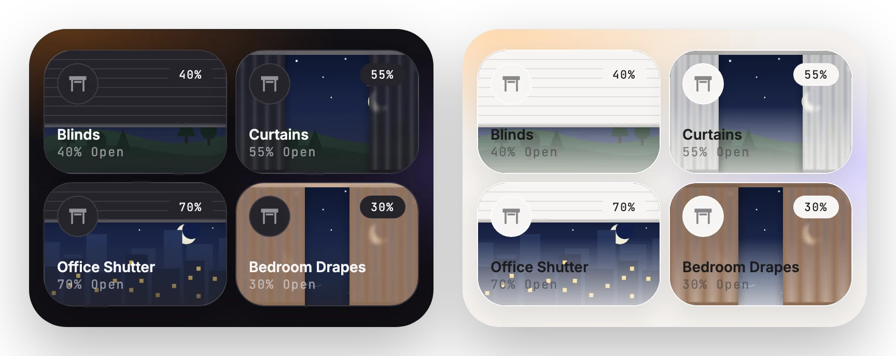
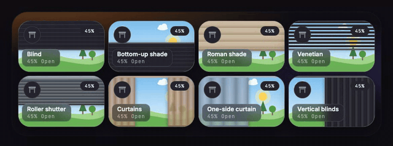

# Cover: blinds and curtains

[← Back to README](../../README.md)



A cover button with a position looks like a window. An outdoor view sits behind it, and the cover opens the way your real one does: a blind from the top, a shade from the sill, curtains from the middle or to one side, and more (see [Styles](#styles)). You can tell at a glance how open it is. You drag the way the cover opens: up and down for blinds and shades, sideways for curtains and vertical blinds.



The view turns to night (moon, stars, lit windows) when `sun.sun` is below the horizon:



## Options

Everything from [Button](button.md), plus:

| Option | Type | Default | Description |
| --- | --- | --- | --- |
| `view` | `garden` \| `sky` \| `city` \| `sea` \| `color` | `garden` | The outdoor scene. `color` keeps the plain colored fill. |
| `view_image` | URL | | Your own photo, for example `/local/yard.jpg`. Used when `view` is not set, and dimmed at night. |
| `cover_style` | see [Styles](#styles) | from device class | How the window opens. Device class `curtain` gets `curtain`, `shutter` gets `shutter`, anything else gets `blind`. |
| `cover_side` | `start` \| `end` | `start` | Where `curtain_side` and `vertical` gather when open. It follows the text direction, so `start` is the right side in Hebrew. |
| `color` | color | theme | On fabric styles (`curtain`, `curtain_side`, `roman`), this tints the fabric. |
| `cover_buttons` | boolean | `false` | Open, stop and close buttons in place of the badge. |

## Styles



| `cover_style` | Looks like | Drag |
| --- | --- | --- |
| `blind` | A roller blind coming down from the top | up opens |
| `bottom_up` | A shade rising from the sill | down opens |
| `roman` | A fabric Roman shade with soft folds and a heavy hem | up opens |
| `venetian` | Horizontal slats. They show the tilt (`current_tilt_position`): thin with gaps when the slats are open, solid when shut. Change the tilt from the more-info dialog (hold) | up opens |
| `shutter` | An outdoor aluminium roller shutter coming down from its box | up opens |
| `curtain` | Two sheer drapes parting from the middle | sideways |
| `curtain_side` | One drape drawn to one side (`cover_side`) | towards that side opens |
| `vertical` | Vertical blinds stacking to one side (`cover_side`) | towards that side opens |

With `view: color` (no window picture), the plain fill grows the way the cover opens: from the bottom, from the top for `bottom_up`, from the middle for `curtain`, or away from the stacking side. The open and close buttons point the same way.

## Examples

<details>
<summary>Blind with a city view</summary>

```yaml
type: custom:glide-card
card_type: button
entity: cover.office
view: city
```
</details>

<details>
<summary>Brown curtains</summary>

```yaml
type: custom:glide-card
card_type: button
entity: cover.bedroom
cover_style: curtain
color: "#b38b6d"
```
</details>

<details>
<summary>Curtain that opens to one side</summary>

```yaml
type: custom:glide-card
card_type: button
entity: cover.living_room
cover_style: curtain_side
cover_side: end
```
</details>

<details>
<summary>Your own photo</summary>

Put the photo in `/config/www/` and refer to it as `/local/...`:

```yaml
type: custom:glide-card
card_type: button
entity: cover.garden
view_image: /local/yard.jpg
```
</details>

<details>
<summary>Open, stop and close buttons</summary>

`cover_buttons: true` adds small round open, stop and close buttons where the badge was; the line under the name still shows the position. Each button shows only when the cover supports it. Open greys out when the cover is fully open, close greys out when it's closed, and stop lights up while the cover moves. This also works on covers without a position, such as a garage door:

```yaml
type: custom:glide-card
card_type: button
entity: cover.garage
cover_buttons: true
```
</details>

> [!NOTE]
> Clouds drift and stars twinkle slowly. Both stop when the device asks for reduced motion.
