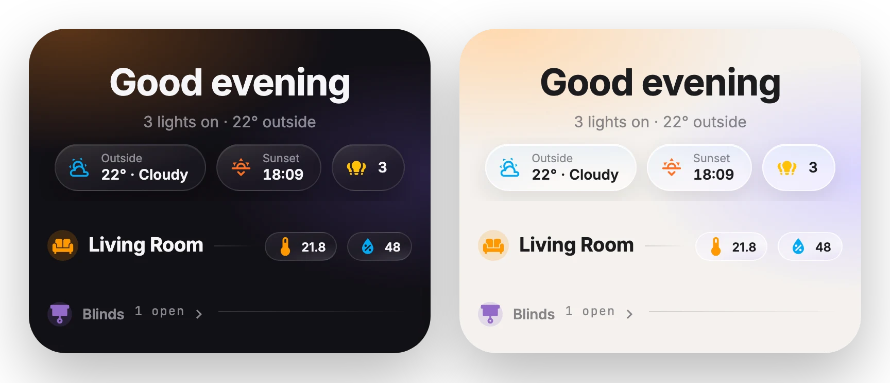

# Heading

[← Back to README](../../README.md)



A section heading to use instead of HA's heading card: a tinted icon, a title, a hairline, and optional mini entity badges at the end. With a `tap_action` it shows a chevron.

## Options

| Option | Type | Description |
| --- | --- | --- |
| `title` | string | **Required.** |
| `subtitle` | string | Small text next to the title (for example "1 open"). |
| `icon` | icon | Icon in a tinted circle. |
| `color` | color | Icon color: HA color name or CSS. |
| `style` | `title` \| `subtitle` | `subtitle` is smaller. |
| `badges` | list | Mini entity badges, with the same options as [chips](chips.md). |
| `tap_action` | action | Makes the heading a link. |

## Example

```yaml
type: custom:glide-card
card_type: heading
title: Living Room
icon: mdi:sofa
color: orange
badges:
  - entity: sensor.living_temp
    icon: mdi:thermometer
  - entity: sensor.living_humidity
    icon: mdi:water-percent
    color: light-blue
tap_action:
  action: navigate
  navigation_path: /dashboard-home/living
```
