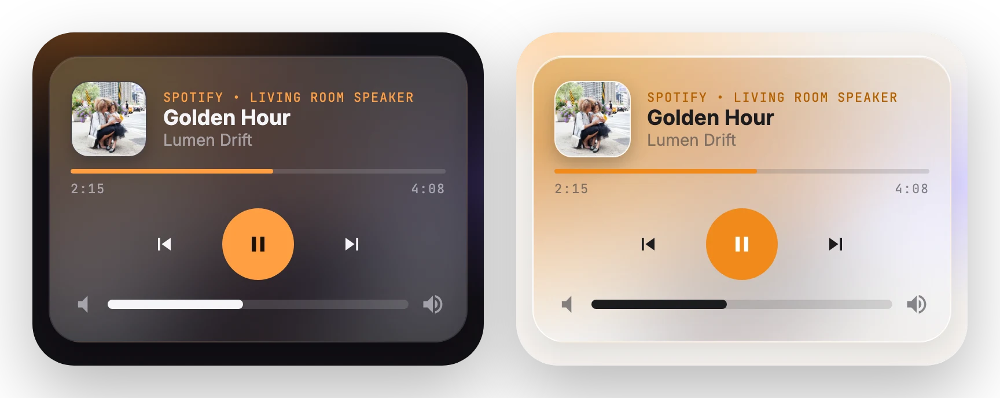

# Media

[← Back to README](../../README.md)



Now playing, with artwork, a progress bar, transport controls and volume. The card picks up a tint from the artwork. `size: slim` gives a one-line player.

## Options

| Option | Type | Description |
| --- | --- | --- |
| `entity` | entity | **Required.** A `media_player` entity. |
| `name` | string | Overrides the friendly name. |
| `size` | `full` \| `compact` \| `slim` | See [sizes](../options.md#sizes). |

## Example

```yaml
type: custom:glide-card
card_type: media
entity: media_player.living_room
```
