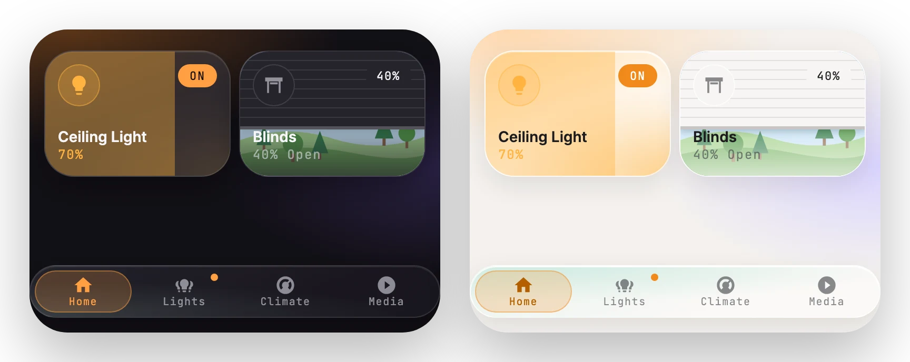

# Nav bar

[← Back to README](../../README.md)



A floating pill bar pinned to the bottom of the screen. A sliding indicator follows the current page. If the items don't fit, the bar scrolls sideways and keeps the active one centred.

## Options

| Option | Type | Description |
| --- | --- | --- |
| `items` | list | **Required.** The buttons. |
| `items[].name` | string | Label. |
| `items[].icon` | icon | Icon. |
| `items[].navigation_path` | string | A dashboard path, or a `#hash` to open a [pop-up](popup.md). Not needed when the item has `items`. |
| `items[].entity` | entity | Shows a dot while the entity is on. |
| `items[].pinned` | boolean | Kept at the end, outside the scrolling part (for example "More"). |
| `items[].items` | list | Turns the item into a small menu that opens above it (for example "More"). Each entry takes `name`, `icon`, `navigation_path` and `entity`, like a bar item. The item is highlighted while you're on one of its pages that isn't already in the bar (so a menu can list every page without a second highlight), and shows a dot while any entry's entity is on. |

## Example

```yaml
type: custom:glide-card
card_type: nav
items:
  - { name: Home, icon: mdi:home, navigation_path: /dashboard-home/0 }
  - { name: Kitchen, icon: mdi:silverware-fork-knife, navigation_path: "#kitchen", entity: light.kitchen }
  - { name: Climate, icon: mdi:thermostat, navigation_path: /dashboard-home/climate }
  - name: More
    icon: mdi:dots-horizontal
    pinned: true
    items:
      - { name: Cameras, icon: mdi:cctv, navigation_path: /dashboard-home/cameras }
      - { name: Pool, icon: mdi:pool, navigation_path: "#pool", entity: switch.pool_pump }
      - { name: Settings, icon: mdi:cog, navigation_path: /config }
```

The menu closes when you pick an entry, tap outside it, or press Escape.

> [!TIP]
> Add the same nav card to every view. The indicator slides over from where it was on the previous page.
