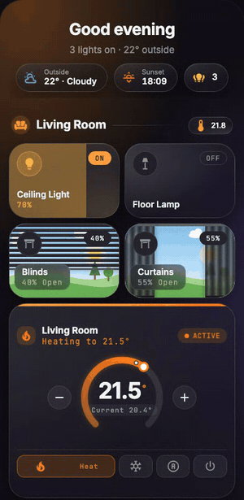

# Pop-up

[← Back to README](../../README.md)



A real sheet that opens when the URL hash matches, like `#kitchen`. It slides up from the bottom on every screen: full width on phones, centred and up to 600px wide on tablets and desktops. Swipe it down, tap outside it, press X or Esc to close.

Any card works inside: Glide cards, HA tiles, Mushroom, and so on.

<br clear="right">

## Options

| Option | Type | Description |
| --- | --- | --- |
| `hash` | string | **Required.** For example `"#kitchen"`. |
| `title` | string | Sheet title. |
| `icon` | icon | Icon next to the title. |
| `entity` | entity | Optional entity whose state shows in the header. |
| `cards` | list | The cards inside the sheet. |
| `size` / `tap_animation` | | Passed on to the Glide cards inside. |

## Example

```yaml
# Put the pop-up anywhere on the view (it takes no space)
type: custom:glide-card
card_type: popup
hash: "#kitchen"
title: Kitchen
icon: mdi:silverware-fork-knife
cards:
  - type: custom:glide-card
    card_type: button
    entity: switch.coffee
  - type: tile
    entity: light.kitchen
```

Open it from any button, chip, heading or nav item:

```yaml
tap_action:
  action: navigate
  navigation_path: "#kitchen"
```

> [!TIP]
> Back (or swiping down) closes the sheet, because opening it adds a history entry.
