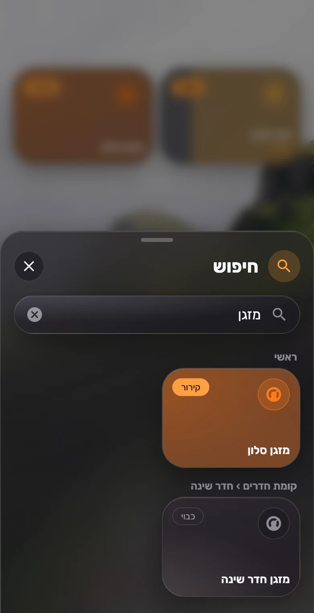

# Search

[← Back to README](../../README.md)



A search sheet over your own dashboard. Type a word and the matching buttons appear, the same cards you already have, grouped by page and pop-up and ready to tap. It searches as you type and also finds:

- **Places**: views and pop-ups whose names match. Tapping one goes there.
- **Rooms**: the page or pop-up name, so `office` lists everything in the office.
- **Device kinds**: `ac`/`מזגן`, `light`/`אור`, `shutter`/`תריס` and so on, even when a button is named after its room.
- **Everything else**: entities that aren't on the dashboard but do something when tapped (lights, switches, covers, climate, scripts, scenes and so on), grouped by HA area, plus sensors last.

Ranking: exact and starts-with matches come first, then what **this device** taps most (counted locally, fading over two weeks, never sent anywhere). Before you type, the sheet shows your most-used buttons.

Control buttons act in place and the sheet stays open. Places close it and navigate. Niqqud, Hebrew final letters, case and punctuation are ignored. The same entity appears once even if it's on several pages, as its named button when there is one. Climate and media cards are shown as buttons. Hidden entities and config/diagnostic entities are skipped.

<br clear="right">

## Options

| Option | Type | Description |
| --- | --- | --- |
| `hash` | string | Opens on this hash. Default `"#search"`. |
| `title` | string | Sheet title. Default "Search" in the user's language. |
| `placeholder` | string | Hint in the search field. |
| `extra_domains` | list | Domains searched beyond the dashboard. Default: light, switch, input_boolean, cover, climate, fan, script, scene, media_player, vacuum, lock, button, input_button, humidifier, water_heater, valve, siren. |
| `include_sensors` | boolean | Also list sensors and binary sensors (read-only, last). Default `true`. |
| `exclude` | list | Entity ids to leave out. `*` matches anything, e.g. `sensor.*_battery`. |
| `frequent` | number | Most-used buttons shown before typing. Default `8`, and `0` hides them. |
| `size` / `tap_animation` / `theme` | | Passed on to the result cards. |

## Example

```yaml
# Anywhere on each view (it takes no space), like a pop-up
type: custom:glide-card
card_type: search
exclude:
  - sensor.*_battery

# Open it from the nav bar
type: custom:glide-card
card_type: nav
items:
  - name: Search
    icon: mdi:magnify
    navigation_path: "#search"
    pinned: true
```
