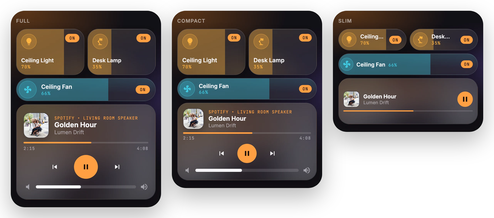
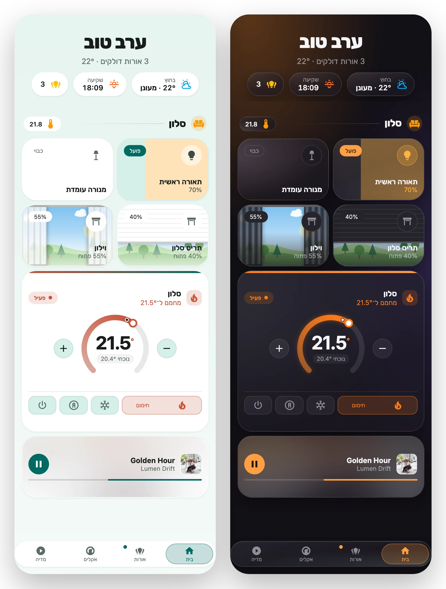

# Shared options

[← Back to README](../README.md)

Every card is `type: custom:glide-card` plus a `card_type`, and accepts these options.

| Option | Values | Description |
| --- | --- | --- |
| `theme` | `glass` (default), `bubble`, `material`, or any registered theme | The design. |
| `mode` | `auto` (default), `dark`, `light` | `auto` follows HA's dark mode. |
| `accent` | any CSS color | Overrides the theme accent. |
| `size` | `full` (default), `compact`, `slim` | See [sizes](#sizes). |
| `tap_animation` | see [below](#tap-animations) | The animation played on tap. |
| `lite` | `true` / `false` | Turns off blur for slow wall tablets. When unset, it's detected automatically. |
| `tap_action` / `hold_action` / `double_tap_action` | HA actions | Standard HA actions (`toggle`, `more-info`, `navigate`, `perform-action`, `url`, `assist`, `none`, with `confirmation`). `navigate` to a `#hash` opens a [pop-up](cards/popup.md). |

## Sizes



- `full`: the standard look.
- `compact`: the same layouts, tighter.
- `slim`: the minimum: one-row tiles, one-line chips, a one-line media player, a small climate dial with −/+ beside it, and an icon-only nav.

In a sections dashboard, tiles, media and climate shrink by whole grid rows. A pop-up passes its size on to its cards.

## Tap animations

`shine` (default), `random` (a different effect on each tap, never the same twice in a row), `press`, `spring`, `ripple`, `glow`, `jelly`, `tilt`, `icon-pop`, `ring`, `deep-press`, `bloom`, `breathe`, `sparks`, `icon-flip`, `border-trace`, `nudge`, `badge-pop`, `none`.

They work on buttons, chips, heading badges and the nav bar, and are turned off when the device asks for reduced motion.

## Dashboard-wide defaults

Set these in your HA theme YAML. A card's own option still wins.

```yaml
my-theme:
  glide-theme: bubble          # theme
  glide-tap-animation: ripple  # tap_animation
  glide-size: compact          # size
```

To force `lite` mode on one device, run `localStorage["glide-card-lite"] = "1"` in that browser's console (`"0"` forces it off).

## Languages and RTL

Cards follow HA's language. Hebrew and other RTL languages mirror the layout: swipes, the nav bar, the dial and the drapes all flip.


