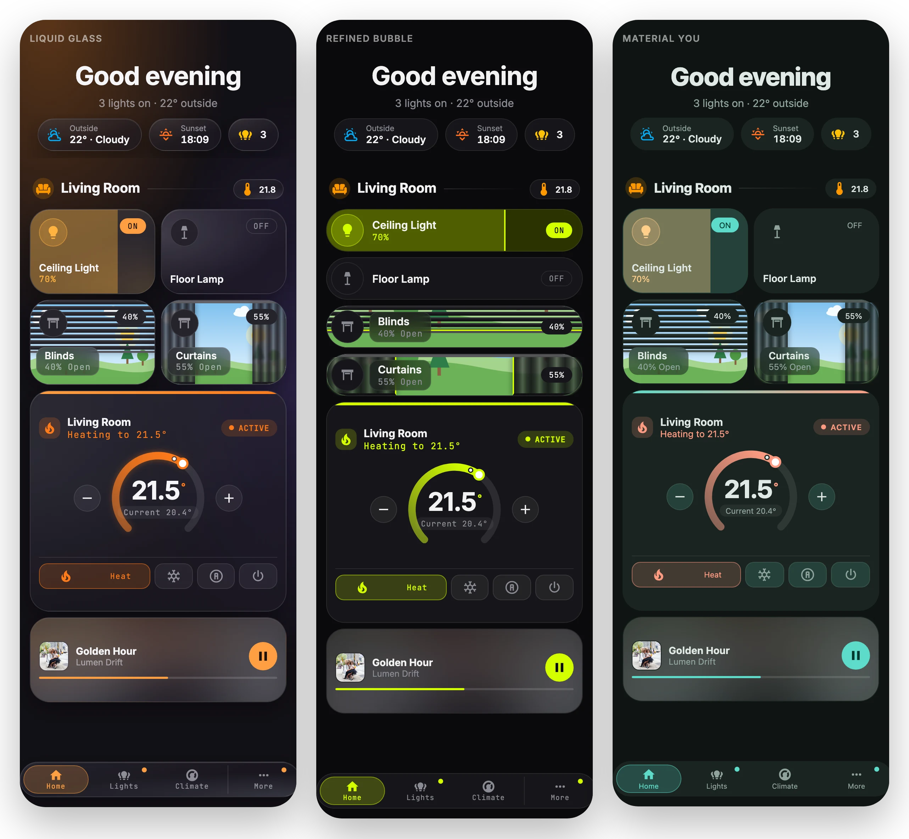

# Themes

[← Back to README](../README.md)

| Liquid Glass | Refined Bubble | Material You |
| --- | --- | --- |
| Frosted translucent tiles with a warm glow | Solid carbon surfaces, full-width pill rows, one electric accent; fast on tablets | Soft tonal surfaces from a teal seed |



Each theme has a dark and a light variant, and `mode: auto` follows HA.

## How themes work

A theme is one object: semantic tokens (`--gc-surface`, `--gc-accent`, `--gc-radius`, `--gc-backdrop`, ...), optional extra CSS per card type, and layout defaults. Cards only read tokens, so a new design never touches card code.

- **Built-in:** add `src/themes/<id>/index.ts` (copy `glass`) and list it in `src/themes/index.ts`.
- **From another HACS resource:**

  ```js
  window.glideCardThemes.register({ id, name, version, preview, tokens: { dark, light } });
  ```

See [`src/themes/types.ts`](../src/themes/types.ts) for the full token contract.
